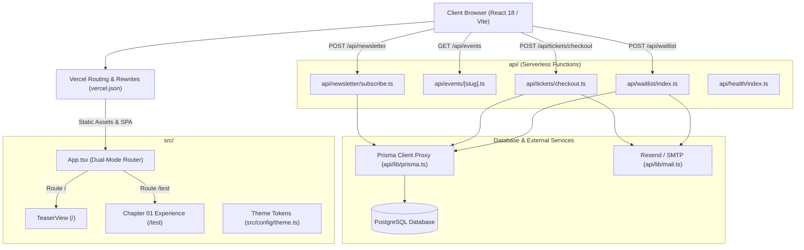

# LØST SØULS — Repository Structure & Architecture

Comprehensive structural overview and technical architecture reference for the **LØST SØULS** digital event platform and teaser portal.

---

## 1. System Overview & Technology Stack

The project is structured as a full-stack, edge-compatible web application designed around the European underground techno aesthetic:

- **Frontend Engine**: [React 18](https://react.dev/) + [TypeScript](https://www.typescriptlang.org/) + [Vite](https://vitejs.dev/)
- **Styling & Motion**: [Tailwind CSS](https://tailwindcss.com/) (custom palette + glowing laser utilities) + [Framer Motion](https://www.framer.com/motion/)
- **Data & Persistence**: [Prisma ORM](https://www.prisma.io/) with PostgreSQL
- **Backend API**: Serverless functions hosted via [Vercel](https://vercel.com/) Node.js runtime (`/api/*`)
- **Email Dispatch**: Resend / SMTP integration with HTML email templating
- **Dual-Mode Routing**:
  - `/`: Public Teaser view with monolithic brand identity, release announcement, and waitlist registration.
  - `/test`: Full digital platform dedicated to Chapter 01 (interactive ticketing matrix, artist roster ledger, apparel capsule, direct-flash gallery, and protocols).



---

## 2. Directory Hierarchy

```
LostSouls-Events/
├── .agents/                    # Agent customization rules & style skills
│   ├── rules/codestyle.md      # Aesthetic & techno styling invariants
│   └── skills/lost-souls-style # Design system skill definitions
├── api/                        # Vercel serverless functions (Node.js API)
│   ├── events/                 # Event data endpoints
│   │   ├── [slug].ts           # Individual event details query
│   │   └── index.ts            # Active events listing endpoint
│   ├── health/                 # Health check endpoint
│   │   └── index.ts            # Runtime & DB connection health
│   ├── lib/                    # Shared backend utilities
│   │   ├── mail.ts             # Email dispatch (confirmation & waitlist)
│   │   └── prisma.ts           # Resilient Prisma client singleton
│   ├── newsletter/             # Newsletter subscription handlers
│   │   └── subscribe.ts        # Mailing list opt-in
│   ├── tickets/                # Ticketing checkout & availability
│   │   ├── availability.ts     # Live ticket tier inventory query
│   │   └── checkout.ts         # Order creation & tier reservation
│   └── waitlist/               # Teaser waitlist registration
│       └── index.ts            # Public waitlist signup endpoint
├── prisma/                     # Database schema and seed scripts
│   ├── schema.prisma           # Prisma data models and relations
│   └── seed.ts                 # Database seed script for Chapter 01
├── public/                     # Static production assets
│   ├── avatar.png              # Monolithic brand visual asset
│   ├── favicon.svg             # SVG brand icon
│   └── lost-souls-avatar.png   # High-resolution avatar
├── scripts/                    # Build and postbuild scripts
│   └── copy-test.mjs           # Copies index.html to dist/test/index.html
├── src/                        # Frontend application source
│   ├── components/             # React UI components
│   │   ├── about/              # Manifesto & curation philosophy
│   │   ├── chapters/           # Conceptual chapter sequence
│   │   ├── common/             # Reusable UI primitives & effects
│   │   ├── events/             # Event overview & dossier
│   │   ├── gallery/            # Direct-flash warehouse photography
│   │   ├── hero/               # Monolithic hero banner & chapter intro
│   │   ├── layout/             # Navigation, TelemetryBar, Footer
│   │   ├── lineup/             # Artist roster ledger
│   │   ├── merch/              # Limited apparel & merch capsule
│   │   ├── originkit/          # Base headless primitives
│   │   ├── protocols/          # Warehouse rules & house etiquette
│   │   ├── teaser/             # Teaser landing page & waitlist form
│   │   └── tickets/            # Interactive ticket matrix
│   ├── config/                 # Central configuration
│   │   └── theme.ts            # Color tokens, glows, typography tokens
│   ├── constants/              # Immutable content & default data
│   │   ├── event.ts            # Fallback event data for Chapter 01
│   │   └── strings.ts          # Centralized copy and UI strings
│   ├── hooks/                  # Custom React hooks
│   │   ├── useAccordion.ts     # Accordion collapse state controller
│   │   ├── useCountdown.ts     # Event countdown timer hook
│   │   ├── useTechnoAudio.ts   # Ambient synthesizer & sound loop hook
│   │   └── useTicketEngine.ts  # Tier selection & price computation engine
│   ├── lib/                    # Frontend resilience proxies
│   │   ├── mail.ts             # Proxy mail exports
│   │   └── prisma.ts           # Frontend fallback proxy for Prisma
│   ├── styles/                 # Cascading stylesheets
│   │   ├── animations.css      # Laser pulse, breathing haze keyframes
│   │   └── globals.css         # Tailwind base, laser glows, scanlines
│   ├── types/                  # TypeScript interface definitions
│   │   ├── event.types.ts      # Event & artist models
│   │   ├── theme.types.ts      # Theme color tokens & hierarchy
│   │   └── ticket.types.ts     # Ticket tiers, status, checkout types
│   ├── App.tsx                 # Root application & dual-route controller
│   └── main.tsx                # React DOM entry point
├── test/                       # Invariant & unit test suites
│   └── invariants.test.mjs     # Theme, strings, & zero-hex-code tests
├── DEPLOYMENT.md               # Production deployment & DB provisioning guide
├── index.html                  # HTML entry point with fonts & metadata
├── package.json                # NPM dependencies & task scripts
├── postcss.config.js           # PostCSS Tailwind & Autoprefixer plugin config
├── STYLEGUIDE.md               # Clean techno aesthetic design rules
├── tailwind.config.ts          # Tailwind theme mapping to src/config/theme.ts
├── tsconfig.json               # TypeScript compiler configuration
└── vercel.json                 # Vercel serverless build & rewrite rules
```

---

## 3. Core Modules & Key Files

### Root & Application Orchestration

- [src/App.tsx](file:///c:/Users/joeyw/GitProjects/LostSouls-Events/src/App.tsx): Triple-route controller orchestrating between:
  - `/`: Public teaser interface with atmospheric Halftone Bloom and waitlist gateway.
  - `/test`: Full event platform populated with dummy data (mock lineup, active ticket tiers, mock capsule images).
  - `/prod`: Production platform layout with zero dummy data and atmospheric "COMING SOON" state across events, stage/lineup, merchandise, and relive the night gallery.
- [src/main.tsx](file:///c:/Users/joeyw/GitProjects/LostSouls-Events/src/main.tsx): Mounts the React application tree to `#root` with standard StrictMode.

- [index.html](file:///c:/Users/joeyw/GitProjects/LostSouls-Events/index.html): HTML5 document head configuring Google Fonts (`Inter`, `Playfair Display`, `JetBrains Mono`), OpenGraph metadata, and viewport properties.
- [vercel.json](file:///c:/Users/joeyw/GitProjects/LostSouls-Events/vercel.json): Configures headers, Prisma bundle inclusions, rewrite rules for SPA client routing, and the `/api/*` endpoints.

### UI Components (`src/components/`)

| Directory | Core Component | Responsibility |
| :--- | :--- | :--- |
| `teaser/` | [TeaserView.tsx](file:///c:/Users/joeyw/GitProjects/LostSouls-Events/src/components/teaser/TeaserView.tsx) | Clean underground teaser hero, monolithic headline, date announcement, and [WaitlistForm.tsx](file:///c:/Users/joeyw/GitProjects/LostSouls-Events/src/components/teaser/WaitlistForm.tsx). |
| `hero/` | [HeroSection.tsx](file:///c:/Users/joeyw/GitProjects/LostSouls-Events/src/components/hero/HeroSection.tsx) | Chapter 01 hero banner, date coordinates, and primary call-to-action buttons. |
| `layout/` | [Navigation.tsx](file:///c:/Users/joeyw/GitProjects/LostSouls-Events/src/components/layout/Navigation.tsx) | Fixed header bar with brand title, chapter indicator, and access action. |
| `layout/` | [TelemetryBar.tsx](file:///c:/Users/joeyw/GitProjects/LostSouls-Events/src/components/layout/TelemetryBar.tsx) | Coordinate ticker and event telemetry indicators (`52.3676° N`, `4.9041° E`). |
| `layout/` | [Footer.tsx](file:///c:/Users/joeyw/GitProjects/LostSouls-Events/src/components/layout/Footer.tsx) | Community newsletter dispatch form, legal copyright, and editorial brand signoff. |
| `events/` | [EventsSection.tsx](file:///c:/Users/joeyw/GitProjects/LostSouls-Events/src/components/events/EventsSection.tsx) | Event dossier, date countdown, and ticketing matrix container. |
| `tickets/` | [TicketMatrix.tsx](file:///c:/Users/joeyw/GitProjects/LostSouls-Events/src/components/tickets/TicketMatrix.tsx) | Interactive tier selector (Community, Early, Regular, Final), order calculation, and checkout modal. |
| `lineup/` | [LineupLedger.tsx](file:///c:/Users/joeyw/GitProjects/LostSouls-Events/src/components/lineup/LineupLedger.tsx) | Artist timetable and performance formats (Hybrid Live, Special Closing, B2B). |
| `about/` | [AboutSection.tsx](file:///c:/Users/joeyw/GitProjects/LostSouls-Events/src/components/about/AboutSection.tsx) | Collective manifesto: sonic purity, strict no-phone etiquette, community autonomy. |
| `merch/` | [SmallRuns.tsx](file:///c:/Users/joeyw/GitProjects/LostSouls-Events/src/components/merch/SmallRuns.tsx) | Minimalist heavyweight textile capsules and physical artifacts showcase. |
| `gallery/` | [GallerySection.tsx](file:///c:/Users/joeyw/GitProjects/LostSouls-Events/src/components/gallery/GallerySection.tsx) | Direct-flash warehouse photography collection and crowd imagery. |
| `protocols/` | [ProtocolsSection.tsx](file:///c:/Users/joeyw/GitProjects/LostSouls-Events/src/components/protocols/ProtocolsSection.tsx) | Mandatory warehouse protocols (camera policy, zero harassment, space awareness). |
| `common/` | [GlowButton.tsx](file:///c:/Users/joeyw/GitProjects/LostSouls-Events/src/components/common/GlowButton.tsx) | High-contrast pill buttons (`rounded-full`) with electric/cyan gradients. |
| `common/` | [LivingBlueGlow.tsx](file:///c:/Users/joeyw/GitProjects/LostSouls-Events/src/components/common/LivingBlueGlow.tsx) | Organic morphing bottom-center subterranean blue shadow. |
| `common/` | [Noise.tsx](file:///c:/Users/joeyw/GitProjects/LostSouls-Events/src/components/common/Noise.tsx) | Analog film grain overlay adding texture to the pitch-black backdrop canvas. |

### Design System & Theming (`src/config/` & `src/styles/`)

- [src/config/theme.ts](file:///c:/Users/joeyw/GitProjects/LostSouls-Events/src/config/theme.ts): Single source of truth for colors (`void.pure`, `void.abyss`, `blue.cobalt`, `blue.laserCyan`, `monochrome.hairline`), typography rules, and luminescence tokens.
- [tailwind.config.ts](file:///c:/Users/joeyw/GitProjects/LostSouls-Events/tailwind.config.ts): Exposes theme tokens directly into Tailwind utility classes (`bg-ls-void-pure`, `text-ls-blue-laserCyan`, `border-ls-mono-hairline`).
- [src/styles/animations.css](file:///c:/Users/joeyw/GitProjects/LostSouls-Events/src/styles/animations.css): Keyframe animations for breathing haze, pulse glows, and laser scan transitions.

### Serverless API Layer (`api/`)

- [api/waitlist/index.ts](file:///c:/Users/joeyw/GitProjects/LostSouls-Events/api/waitlist/index.ts): Validates incoming emails, persists them to `WaitlistSubscriber` table, and dispatches a confirmation email.
- [api/tickets/availability.ts](file:///c:/Users/joeyw/GitProjects/LostSouls-Events/api/tickets/availability.ts): Returns real-time capacity and sold status for ticket tiers.
- [api/tickets/checkout.ts](file:///c:/Users/joeyw/GitProjects/LostSouls-Events/api/tickets/checkout.ts): Creates `Order` records, increments `soldCount`, and issues tickets.
- [api/newsletter/subscribe.ts](file:///c:/Users/joeyw/GitProjects/LostSouls-Events/api/newsletter/subscribe.ts): Stores email in `NewsletterSubscriber` table.
- [api/health/index.ts](file:///c:/Users/joeyw/GitProjects/LostSouls-Events/api/health/index.ts): Ping endpoint confirming database reachability and API status.
- [api/lib/prisma.ts](file:///c:/Users/joeyw/GitProjects/LostSouls-Events/api/lib/prisma.ts): Resilient Prisma client wrapper that safely degrades gracefully if `DATABASE_URL` is unconfigured.
- [api/lib/mail.ts](file:///c:/Users/joeyw/GitProjects/LostSouls-Events/api/lib/mail.ts): Resend / SMTP email delivery engine with stylized HTML techno templates.

### Data Model & Persistence (`prisma/`)

Defined in [prisma/schema.prisma](file:///c:/Users/joeyw/GitProjects/LostSouls-Events/prisma/schema.prisma):
- **Event**: Top-level event record (slug, chapter, venue, city, doors).
- **Artist**: Lineup details linked to an event (name, performance style, stage, order index).
- **TicketTier**: Ticket inventory tiers (name, priceCents, capacity, soldCount, status).
- **Order & OrderItem**: Ticket purchase records and customer information.
- **NewsletterSubscriber**: General marketing mailing list subscribers.
- **WaitlistSubscriber**: Pre-launch waitlist signups for early access.

---

## 4. Architectural Rules & Invariants

1. **Zero Hardcoded Hex in Components**:
   - Enforced by [test/invariants.test.mjs](file:///c:/Users/joeyw/GitProjects/LostSouls-Events/test/invariants.test.mjs).
   - All colors must utilize semantic Tailwind classes derived from `THEME.colors` (e.g. `text-ls-blue-laserCyan` or `bg-ls-void-abyss`).
2. **Clean Techno Visual Language**:
   - Strict adherence to [STYLEGUIDE.md](file:///c:/Users/joeyw/GitProjects/LostSouls-Events/STYLEGUIDE.md).
   - No matrix artifacts, 90s terminal ASCII, bracketed badges (`[ ]`), or spreadsheet table borders.
   - Buttons are rounded-full pills (`rounded-full`), cards are monolithic sharp slabs (`rounded-none`).
3. **Typography Invariants**:
   - Brand name is always formatted as **`LØST SØULS`** with Scandinavian slashed Ø.
   - Headers use editorial serif (`font-editorial`), descriptions use sans-serif (`font-sans`), and coordinates/numbers use monospace (`font-mono`).
4. **Database Resilience**:
   - `prisma.ts` exports a fallback proxy so the serverless API and test runner will not throw uncaught fatal errors if `DATABASE_URL` is empty.

---

## 5. Development & Testing Commands

```bash
# Start local Vite development server
npm run dev

# Generate Prisma Client and build production bundle
npm run build

# Run automated project invariants and resilience tests
npm test

# Seed database with Chapter 01 event, artists, and ticket tiers
npm run prisma:seed

# Preview production build locally
npm run preview
```
